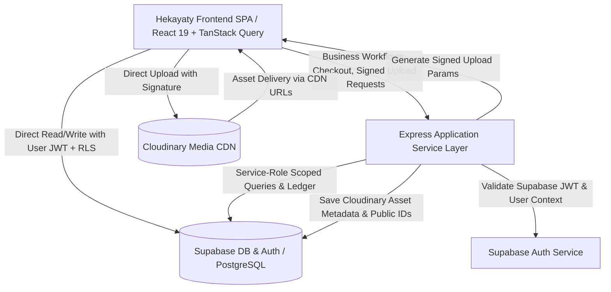

# HEKAYATY (حكاياتي) — OFFICIAL BACKEND MASTER SPECIFICATION
## Hybrid Architecture: Supabase + Express + Cloudinary + React Frontend

---

## 1. Executive Summary & Architectural Foundation

**Hekayaty** (حكاياتي) is an Arabic-first storytelling universe, comics ecosystem, and literary marketplace. To ensure scale, resilience, security, and velocity, the platform adopts an **Official Hybrid Backend Architecture**:

1. **Supabase (Data & Identity Foundation)**:
   - Primary PostgreSQL database.
   - Authoritative Single Source of Truth for all persistent platform entities.
   - Supabase Authentication (JWT-based identity and profile management).
   - Database constraints, relational foreign keys, and Row-Level Security (RLS) policies.
   - Supabase CLI SQL migrations as the authoritative database migration path.
2. **Express (Central Business Logic & Orchestration Layer)**:
   - Stateful business workflows, checkout and marketplace orchestration.
   - Server-side authorization and entitlement enforcement for protected Originals content.
   - Payment gateway integration, verified webhook listeners, and refund logic.
   - Financial ledger entries and inventory management for physical publishing items.
   - Cloudinary upload signature generation and media authorization.
   - Requests authenticated via validated Supabase JWTs, operating with user-scoped Supabase clients for user actions and scoped service-role credentials for privileged backend tasks.
3. **Cloudinary (Media & Asset Optimization Engine)**:
   - High-performance asset storage for comic pages, character artwork, world landscapes, book covers, and creator assets.
   - Dynamic transformations (automatic WebP/AVIF formatting, responsive breakpoints, high-DPI handling).
   - Secure signed uploads orchestrated via Express.
   - CDN delivery with zero binary media storage in PostgreSQL.
4. **Existing Frontend (Client Application Layer)**:
   - Preserves the established React 19 / Vite SPA, routing structure (24 core page modules across 96 application endpoints), and authentic literary turquoise/gold visual identity.
   - Direct Supabase client calls for user-scoped, RLS-governed data (user bookmarks, favorites, reading progress, public lore lookups).
   - Express API calls for transactional operations (checkout, subscription management, protected content stream authorization, signed upload requests).

---

## 2. Core Separation of Concerns

| Capability / Concern | Authoritative Component | Mechanism / Protocol |
| :--- | :--- | :--- |
| **User Identity & Passwords** | Supabase Auth | PBKDF2/Argon2 hashing, JWT access tokens, Refresh token rotation |
| **User Profile & Social Metadata** | Supabase Database | `public.profiles` table with 1-to-1 link to `auth.users` |
| **Row-Level Security (RLS)** | Supabase PostgreSQL | Native PostgreSQL RLS policies evaluated per JWT role/uid |
| **Universe Lore (Worlds, Characters, Lore)**| Supabase Database | Publicly queryable tables with RLS read-enabled for `anon` |
| **Comic Reader Page Authorization** | Express Service Layer | Verification of issue entitlement or active subscription before asset delivery |
| **Checkout & Order State Machine** | Express Service Layer | Atomically orchestrated orders, inventory decrement, order status transitions |
| **Payment Webhooks** | Express Service Layer | Cryptographically verified HMAC webhooks |
| **Writer vs. Publisher Role Rules** | Express Service Layer | Hard constraint: Writers limited strictly to digital e-books/stories |
| **Media Delivery & Optimization** | Cloudinary CDN | Responsive delivery, automatic format conversion (f_auto, q_auto) |
| **Media Signature Generation** | Express Service Layer | Signed Cloudinary upload tokens generated using secret API key |

---

## 3. Architecture Integrity Rules

1. **No Competing Databases**: Supabase PostgreSQL is the sole persistent database. Express shall not maintain an independent database.
2. **No Competing Auth**: Express validates Supabase-issued JWTs. Express does not issue independent credentials or store passwords.
3. **No Secrets on Client**:
   - `SUPABASE_SERVICE_ROLE_KEY` is strictly confined to Express backend environment.
   - `CLOUDINARY_API_SECRET` is strictly confined to Express backend environment.
   - Client is provided only with `VITE_SUPABASE_URL`, `VITE_SUPABASE_ANON_KEY`, and `VITE_CLOUDINARY_CLOUD_NAME`.
4. **Authoritative Migrations**: Supabase CLI SQL migrations (`supabase/migrations/*.sql`) constitute the single source of truth for schema evolution. Drizzle ORM acts solely as a type-safe server-side query builder.
5. **Zero Trust on Client Values**: Client-sent prices, subscription tiers, role names, and ledger balances are completely ignored and re-computed authoritatively from the database.
