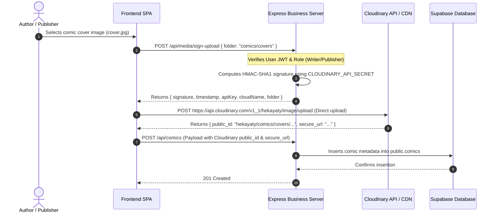

# HEKAYATY (حكاياتي) — CLOUDINARY MEDIA ARCHITECTURE SPECIFICATION

Cloudinary is the single official media platform for Hekayaty, handling storage, transformation, dynamic optimization, and CDN delivery for all visual storytelling assets.

---

## 1. Folder Hierarchy & Media Taxonomies

All assets are stored under the root `hekayaty/` namespace in Cloudinary:

```
hekayaty/
├── comics/
│   ├── covers/          # High-resolution comic book cover art
│   └── pages/           # Internal comic reading pages (protected assets)
├── stories/
│   └── covers/          # Illustrated prose covers & chapter headers
├── characters/
│   ├── portraits/       # Official character dossiers & portraits
│   └── avatars/         # Character thumbnail icons
├── worlds/
│   ├── panoramas/       # Cinematic world landscapes & architecture
│   └── maps/            # Planetary & regional cartography
├── merchandise/
│   ├── physical_books/  # Hardcover & softcover mockups
│   └── card_game/       # Hero & villain battle card artwork
├── users/
│   └── avatars/         # User profile pictures
└── editorial/
    └── banners/         # Announcements, event posters, marketing assets
```

---

## 2. Cloudinary Transformation Profiles

### 2.1 Optimization Standards (Universal URL Flags)
All delivered URLs must utilize automatic format and quality flags:
`f_auto,q_auto`
- `f_auto`: Automatically serves AVIF or WebP to supporting modern browsers, falling back to JPEG/PNG.
- `q_auto`: Intelligent perceptually lossless compression reducing byte weights by up to 60%.

### 2.2 Standard Named Transformations

| Profile | Transformation URL Fragment | Primary Use Cases |
| :--- | :--- | :--- |
| **Comic Cover (High-Res)** | `c_fill,w_800,h_1200,f_auto,q_auto` | Comic detail view, featured carousels |
| **Comic Cover (Grid Card)** | `c_fill,w_400,h_600,f_auto,q_auto` | Comics hub grid, search thumbnails |
| **Character Portrait** | `c_fill,w_600,h_800,g_face,f_auto,q_auto` | Character detail dossier, power meters |
| **World Panorama** | `c_fill,w_1920,h_1080,f_auto,q_auto` | World detail hero banner, cinematic backdrop |
| **User Avatar (Circle)** | `c_fill,w_200,h_200,g_face,r_max,f_auto,q_auto` | Navbar profile pill, community comments |
| **Reader Page (Full View)** | `c_limit,w_1600,h_2400,f_auto,q_auto:best` | Comic reader canvas, zoomable pages |

---

## 3. Storage in Supabase: Metadata Model

**Binary image data is NEVER stored in PostgreSQL.**
Instead, the database stores the Cloudinary `public_id` and full `secure_url`:

```sql
-- Example row in public.characters
{
  "id": "c1",
  "name_ar": "زايد الذهبي",
  "image_url": "https://res.cloudinary.com/hekayaty/image/upload/f_auto,q_auto/v1720000000/hekayaty/characters/portraits/zayed.jpg",
  "cloudinary_image_public_id": "hekayaty/characters/portraits/zayed"
}
```

### Advantages:
1. **Dynamic URL Building**: If the frontend needs a 300px thumbnail instead of an 800px image, it derives it instantly on the fly:
   `https://res.cloudinary.com/hekayaty/image/upload/c_fill,w_300,h_400,f_auto,q_auto/v1/hekayaty/characters/portraits/zayed`
2. **Zero Storage Waste**: Database backups remain lightning fast and compact (<50MB).
3. **Cache Invalidation**: Updating an asset preserves the same public ID while incrementing the Cloudinary version timestamp `v{timestamp}`.

---

## 4. Secure Signed Upload Workflow


