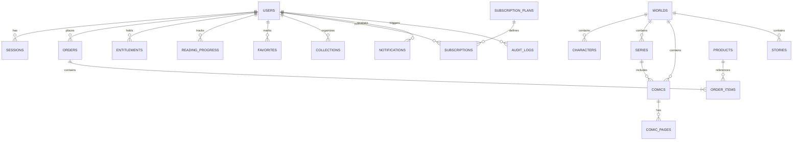

# HEKAYATY (حكاياتي) — DATABASE ARCHITECTURE & SCHEMA SPECIFICATION

## 1. Relational Entity Overview

---

## 2. Table Specifications & Indexes

### 2.1 Users & Authentication
- `users`:
  - `id` (serial primary key)
  - `email` (text, unique indexed)
  - `password_hash` (text, not null)
  - `role` (enum: `reader`, `writer`, `publishing_house`, `admin`)
  - `display_name` (text, not null)
  - `avatar_url` (text, nullable)
  - `bio` (text, nullable)
  - `is_email_verified` (boolean, default false)
  - `email_verification_token` (text, nullable)
  - `password_reset_token` (text, nullable)
  - `password_reset_expires_at` (timestamp, nullable)
  - `is_active` (boolean, default true)
  - `last_login_at` (timestamp, nullable)
  - `created_at`, `updated_at`
- `sessions`:
  - `id` (uuid text, primary key)
  - `user_id` (foreign key -> users.id, on delete cascade)
  - `token` (text, unique indexed)
  - `expires_at` (timestamp, not null)
  - `created_at` (timestamp, default now)
  - `ip_address`, `user_agent`

### 2.2 Universe Entities
- `worlds`: `id` (text PK, e.g. 'w1'), `name_ar`, `name_en`, `description_ar`, `description_en`, `ruler`, `ruler_ar`, `alignment` ('light'|'dark'|'neutral'), `climate`, `climate_ar`, `history_ar`, `image_url`, `notable_locations` (jsonb), `organizations` (jsonb).
- `characters`: `id` (text PK, e.g. 'c1'), `name_ar`, `name_en`, `alias`, `alias_ar`, `alignment` ('hero'|'villain'|'antihero'|'neutral'), `world_id` (FK -> worlds.id), `bio_ar`, `bio_en`, `origin_ar`, `powers` (jsonb), `stats` (jsonb: strength, speed, durability, intelligence, magic, combat), `image_url`, `classification` ('original'|'hekayaty_selected'|'official_collaboration').
- `series`: `id` (text PK), `title_ar`, `title_en`, `description_ar`, `cover_image_url`, `classification`, `world_id` (FK), `genres_ar` (jsonb), `status` ('ongoing'|'completed'|'hiatus'), `issue_count`.
- `comics`: `id` (text PK), `series_id` (FK), `title_ar`, `title_en`, `issue_number`, `synopsis_ar`, `writer`, `artist`, `year`, `month`, `cover_image_url`, `character_ids` (jsonb), `world_id` (FK), `rating`, `page_count`, `classification`, `is_free`, `price_egp`.
- `comic_pages`: `id` (serial PK), `comic_id` (FK -> comics.id cascade), `page_number` (int), `image_url` (text). Indexed by `(comic_id, page_number)`.
- `stories`: `id` (text PK), `title_ar`, `title_en`, `author_ar`, `synopsis_ar`, `cover_image_url`, `genres_ar` (jsonb), `classification`, `character_ids` (jsonb), `world_id` (FK), `word_count`, `read_time_minutes`, `year`, `content` (text), `is_free`, `price_egp`.

### 2.3 Lore, Timeline & Encyclopedia
- `timeline_events`: `id` (text PK), `title_ar`, `title_en`, `year`, `era` ('ancient'|'classical'|'modern'|'future'), `description_ar`, `category`, `character_ids` (jsonb), `world_ids` (jsonb), `comic_ids` (jsonb), `image_url`, `impact` ('minor'|'major'|'legendary').
- `encyclopedia_entries`: `id` (text PK), `title_ar`, `title_en`, `category` ('artifact'|'technology'|'organization'|'creature'|'location'), `description_ar`, `tags` (jsonb), `related_entry_ids` (jsonb), `related_character_ids` (jsonb), `image_url`.
- `news_articles`: `id` (text PK), `title_ar`, `summary_ar`, `content_ar`, `image_url`, `tags` (jsonb), `published_at`, `is_featured`.
- `events`: `id` (text PK), `title_ar`, `description_ar`, `image_url`, `event_date`, `location`, `is_online`.
- `card_game_cards`: `id` (text PK), `name_ar`, `name_en`, `type`, `rarity`, `character_id` (FK), `image_url`, `stats` (jsonb), `abilities` (jsonb), `flavor_text_ar`, `price_egp`, `stock_count`.

### 2.4 User State, Commerce & Subscriptions
- `reading_progress`: `id` (serial PK), `user_id` (FK), `content_type` ('comic'|'story'), `content_id` (text), `progress` (int), `is_completed` (bool). Unique `(user_id, content_type, content_id)`.
- `favorites`: `id` (serial PK), `user_id` (FK), `content_type`, `content_id`. Unique `(user_id, content_type, content_id)`.
- `collections`: `id` (serial PK), `user_id` (FK), `name_ar`, `content_ids` (jsonb).
- `products`: `id` (serial PK), `content_type`, `content_id`, `name_ar`, `price_egp`, `is_digital`, `stock_count`, `is_active`.
- `orders`: `id` (serial PK), `user_id` (FK), `status` ('pending'|'paid'|'processing'|'shipped'|'delivered'|'cancelled'), `total_egp`, `payment_method`, `payment_ref`, `shipping_address` (jsonb).
- `order_items`: `id` (serial PK), `order_id` (FK), `product_id` (FK), `quantity`, `unit_price_egp`.
- `entitlements`: `id` (serial PK), `user_id` (FK), `content_type`, `content_id`, `source` ('purchase'|'subscription'|'free'), `expires_at`. Unique `(user_id, content_type, content_id)`.
- `subscription_plans`: `id` (serial PK), `name_ar`, `name_en`, `price_egp_monthly`, `price_egp_yearly`, `features` (jsonb), `is_active`.
- `subscriptions`: `id` (serial PK), `user_id` (FK), `plan_id` (FK), `status` ('active'|'cancelled'|'expired'), `current_period_start`, `current_period_end`.
- `notifications`: `id` (serial PK), `user_id` (FK), `type`, `title_ar`, `body_ar`, `link_url`, `is_read`.
- `audit_logs`: `id` (serial PK), `user_id` (FK nullable), `action`, `resource_type`, `resource_id`, `metadata` (jsonb), `ip_address`, `created_at`.
