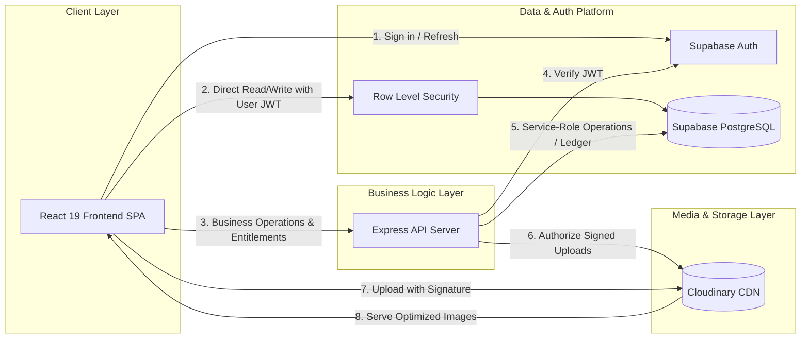
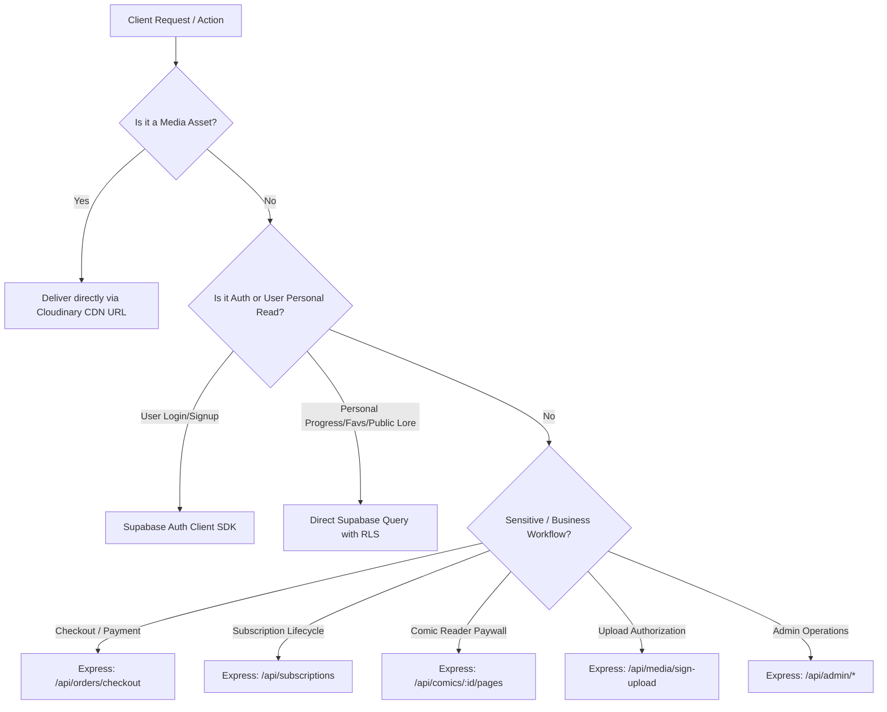

# HEKAYATY (حكاياتي) — HYBRID ARCHITECTURE SPECIFICATION
## Supabase · Express · Cloudinary · Frontend Interaction Model

---

## 1. Tri-Tier Architectural Boundaries

The platform architecture partitions responsibilities into three distinct backend layers cooperating with the existing client:

---

## 2. Request Routing Decision Tree

Every client action follows an unambiguous routing path:

---

## 3. Integration Patterns

### 3.1 Pattern A: Direct Supabase Data Operations (Client ↔ Supabase)
Used for data operations where PostgreSQL Row-Level Security provides complete authorization guarantees:
- **Public Reads**: Worlds catalog, Characters dossier, Series list, Published free lore, Timeline events, Encyclopedia entries, Community announcements.
- **User-Scoped Operations**:
  - `reading_progress` (User can read and upsert only records where `user_id = auth.uid()`).
  - `favorites` (User can read and toggle only records where `user_id = auth.uid()`).
  - `collections` (User can manage personal reading collections where `user_id = auth.uid()`).
  - `profiles` (User can view public profiles, edit only own profile).

### 3.2 Pattern B: Express Business Orchestration (Client ↔ Express ↔ Supabase)
Used whenever server validation, external API calls, financial mutations, or role authorization rules are required:
- **Authentication Header**: Every request to Express transmits `Authorization: Bearer <supabase_access_token>`.
- **JWT Verification**: Express parses the JWT using Supabase JWT secret or JWKS public keys.
- **Client Instantiation**:
  - For user-scoped backend queries: Express initializes `createClient(SUPABASE_URL, SUPABASE_ANON_KEY, { global: { headers: { Authorization: `Bearer ${token}` } } })`. This ensures RLS policies apply even to server-executed queries.
  - For administrative/financial operations: Express uses `createClient(SUPABASE_URL, SUPABASE_SERVICE_ROLE_KEY)`.

### 3.3 Pattern C: Secure Media Upload Flow (Client ↔ Express ↔ Cloudinary)
1. **Request Signature**: Client calls Express `POST /api/media/sign-upload` with target folder (e.g. `covers`, `avatars`, `pages`) and file metadata.
2. **Permission Check**: Express verifies user role (e.g., only writers/publishers can upload book covers; any user can upload avatar).
3. **Generate Signature**: Express generates a timestamped HMAC-SHA1 signature using `CLOUDINARY_API_SECRET`.
4. **Direct Client Upload**: Client sends multipart form directly to Cloudinary upload API with the signature.
5. **Asset Persistence**: Client sends returned Cloudinary `public_id` and `secure_url` to Express/Supabase to link to the respective entity.
