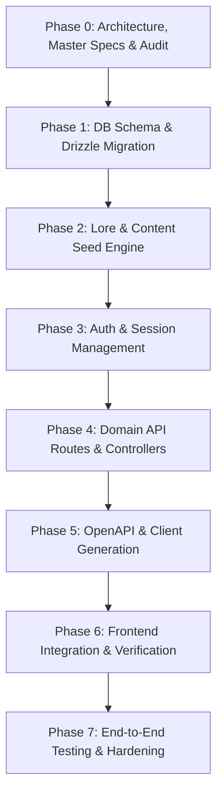

# HEKAYATY (حكاياتي) — IMPLEMENTATION ROADMAP & MIGRATION PLAN

## Phase Progression

---

## Detailed Milestone Checklist

- [x] **Milestone 0: Baseline & Architecture Audit**
  - Confirmed repository layout (`artifacts/hekayaty-world`, `artifacts/api-server`, `lib/db`, `lib/api-spec`).
  - Identified data models from `mockData.ts`.
  - Delivered 7 core master specification documents.

- [x] **Milestone 1: Relational Schema & Database Configuration**
  - Complete PostgreSQL Drizzle schema configured in `lib/db/src/schema/index.ts`.
  - Configured 18 tables: `users`, `sessions`, `worlds`, `characters`, `series`, `comics`, `comic_pages`, `stories`, `timeline_events`, `encyclopedia_entries`, `news_articles`, `events`, `card_game_cards`, `products`, `orders`, `order_items`, `entitlements`, `subscriptions`, `notifications`, `audit_logs`.
  - Verified clean TypeScript compilation in `lib/db`.

- [ ] **Milestone 2: Lore Data Seed Script**
  - Script to import all established Arabic lore (worlds, characters, comics, timeline, encyclopedia) from `mockData.ts` into PostgreSQL.
  - Generates default test accounts: reader, writer, publishing house, admin.

- [ ] **Milestone 3: Express Backend Route Handlers**
  - Modular routers in `artifacts/api-server/src/routes/`:
    - `auth.ts` (register, login, me, logout)
    - `worlds.ts`, `characters.ts`, `series.ts`, `comics.ts`, `stories.ts`
    - `timeline.ts`, `encyclopedia.ts`, `news.ts`, `events.ts`, `cards.ts`
    - `user.ts` (progress, favorites, collections)
    - `orders.ts` & `subscriptions.ts`
    - `search.ts`

- [ ] **Milestone 4: Auth & Access Control Middleware**
  - Session verification middleware with HTTP-only cookies.
  - Role-based authorization (`requireRole`).
  - Paywall/entitlement guard for comic pages.

- [ ] **Milestone 5: Frontend API Client & State Connection**
  - Update `useAppStore` to sync reading progress and favorites with backend APIs.
  - Provide fallback to mock data when server is in offline/demo mode so the site never breaks.
