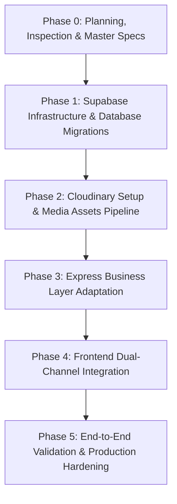

# HEKAYATY (حكاياتي) — OFFICIAL HYBRID MIGRATION ROADMAP

This document outlines the ordered, non-destructive migration roadmap transitioning the existing codebase to the official Supabase + Express + Cloudinary hybrid architecture.

---

## 1. Migration Phase Overview

---

## 2. Detailed Phase Breakdown

### Phase 0: Planning & Repository Inspection (CURRENT PHASE — COMPLETE)
- [x] Complete codebase inspection of frontend (Vite/React 19), Express server, and database libraries.
- [x] Establish official hybrid architecture boundaries (Supabase, Express, Cloudinary).
- [x] Author all 9 master architectural documents.
- [x] Verify that current dev servers (Vite 3000, Express 3001) build and run cleanly with zero errors.

### Phase 1: Supabase Infrastructure & Database Migrations
- [ ] Initialize Supabase CLI configuration in `supabase/config.toml`.
- [ ] Create initial migration file: `supabase/migrations/20261120000000_init_hekayaty_schema.sql` incorporating the complete DDL from [SUPABASE_DATABASE_ARCHITECTURE.md](file:///e:/Hekayaty%202027/Hekaty-World/SUPABASE_DATABASE_ARCHITECTURE.md).
- [ ] Create RLS migration file: `supabase/migrations/20261120000001_enable_rls_policies.sql` containing all policies from [SUPABASE_RLS_POLICY_MATRIX.md](file:///e:/Hekayaty%202027/Hekaty-World/SUPABASE_RLS_POLICY_MATRIX.md).
- [ ] Create seed migration: `supabase/seed.sql` populating the complete Hekayaty lore (Zalamar, Nova Qadim, Zayed, Lailat, Farhan, Comics, Stories).
- [ ] Configure Supabase Authentication settings (email signups, redirect URLs, JWT expiry).

### Phase 2: Cloudinary Media Assets Pipeline
- [ ] Configure Cloudinary credentials in Express (`CLOUDINARY_CLOUD_NAME`, `CLOUDINARY_API_KEY`, `CLOUDINARY_API_SECRET`).
- [ ] Create media upload orchestration script to batch-upload attached assets (`attached_assets/generated_images/*`) to their respective Cloudinary folders (`hekayaty/worlds`, `hekayaty/characters`, etc.).
- [ ] Update database seed records to reference Cloudinary `public_id`s and optimized transformation URLs.

### Phase 3: Express Business Layer Adaptation
- [ ] Install `@supabase/supabase-js` and `cloudinary` in `artifacts/api-server`.
- [ ] Replace custom scrypt password logic with Supabase JWT verification middleware (`verifySupabaseJWT`).
- [ ] Adapt route handlers to use user-scoped Supabase client for user actions and Service-Role client for checkout/entitlements.
- [ ] Implement `POST /api/media/sign-upload` for signed Cloudinary uploads.
- [ ] Retain existing in-memory / mock fallback mode for local offline execution.

### Phase 4: Frontend Dual-Channel Integration
- [ ] Install `@supabase/supabase-js` in `artifacts/hekayaty-world`.
- [ ] Add `@/lib/supabaseClient.ts` initializing Supabase client with `VITE_SUPABASE_URL` and `VITE_SUPABASE_ANON_KEY`.
- [ ] Connect `Navbar.tsx` and `Profile.tsx` to Supabase Auth (`supabase.auth.onAuthStateChange`).
- [ ] Connect `useAppStore.ts` progress/favorites to sync with Supabase tables when user is authenticated.
- [ ] Ensure all 24 page routes maintain 100% visual and functional stability.

### Phase 5: Production Validation & Security Audit
- [ ] Execute automated test suite validating Supabase RLS boundaries.
- [ ] Verify that unauthorized requests cannot access protected comic pages (`/comics/:id/pages`).
- [ ] Verify that writers cannot publish physical products.
- [ ] Verify that Cloudinary upload signatures reject forged folder targets.
- [ ] Audit bundle sizes and performance metrics.
