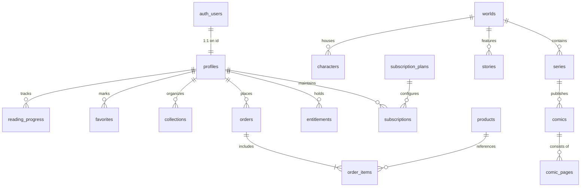

# HEKAYATY (حكاياتي) — SUPABASE DATABASE ARCHITECTURE & DDL SPECIFICATION

---

## 1. Schema Layout & Migration Standard

The database architecture is designed natively for PostgreSQL 16 on Supabase.
All schema changes are authored as sequential SQL migrations in `supabase/migrations/` (e.g., `20261120000000_init_hekayaty_schema.sql`).



---

## 2. Definitive Database DDL (Supabase SQL)

### 2.1 Custom Enums & Extensions
```sql
-- Extensions
CREATE EXTENSION IF NOT EXISTS "uuid-ossp";

-- Enumerations
CREATE TYPE user_role AS ENUM ('reader', 'writer', 'publishing_house', 'admin');
CREATE TYPE content_classification AS ENUM ('original', 'hekayaty_selected', 'official_collaboration');
CREATE TYPE world_alignment AS ENUM ('light', 'dark', 'neutral');
CREATE TYPE character_alignment AS ENUM ('hero', 'villain', 'antihero', 'neutral');
CREATE TYPE publication_status AS ENUM ('draft', 'review', 'published', 'archived');
CREATE TYPE comic_status AS ENUM ('ongoing', 'completed', 'hiatus');
CREATE TYPE order_status AS ENUM ('pending', 'paid', 'processing', 'shipped', 'delivered', 'cancelled', 'refunded');
CREATE TYPE subscription_status AS ENUM ('active', 'cancelled', 'expired', 'trialing');
CREATE TYPE timeline_era AS ENUM ('ancient', 'classical', 'modern', 'future');
CREATE TYPE timeline_category AS ENUM ('catastrophe', 'creation', 'conflict', 'political', 'discovery', 'resurgence', 'expansion');
CREATE TYPE encyclopedia_category AS ENUM ('artifact', 'technology', 'organization', 'creature', 'location');
```

### 2.2 User Profiles & Role Mapping (Linked to `auth.users`)
```sql
CREATE TABLE public.profiles (
    id UUID PRIMARY KEY REFERENCES auth.users(id) ON DELETE CASCADE,
    email TEXT NOT NULL UNIQUE,
    display_name TEXT NOT NULL,
    avatar_url TEXT,
    cloudinary_avatar_public_id TEXT,
    bio TEXT,
    role user_role NOT NULL DEFAULT 'reader',
    is_active BOOLEAN NOT NULL DEFAULT true,
    created_at TIMESTAMPTZ NOT NULL DEFAULT now(),
    updated_at TIMESTAMPTZ NOT NULL DEFAULT now()
);

-- Trigger to create public.profiles upon auth.users signup
CREATE OR REPLACE FUNCTION public.handle_new_user()
RETURNS TRIGGER AS $$
BEGIN
    INSERT INTO public.profiles (id, email, display_name, role)
    VALUES (
        new.id,
        new.email,
        COALESCE(new.raw_user_meta_data->>'display_name', split_part(new.email, '@', 1)),
        COALESCE((new.raw_user_meta_data->>'role')::user_role, 'reader'::user_role)
    );
    RETURN NEW;
END;
$$ LANGUAGE plpgsql SECURITY DEFINER;

CREATE OR REPLACE TRIGGER on_auth_user_created
    AFTER INSERT ON auth.users
    FOR EACH ROW EXECUTE FUNCTION public.handle_new_user();
```

### 2.3 Universe Lore Tables
```sql
-- Worlds
CREATE TABLE public.worlds (
    id TEXT PRIMARY KEY, -- e.g. 'w1'
    name_ar TEXT NOT NULL,
    name_en TEXT NOT NULL,
    description_ar TEXT NOT NULL,
    description_en TEXT NOT NULL,
    ruler_ar TEXT,
    ruler_en TEXT,
    alignment world_alignment NOT NULL DEFAULT 'neutral',
    climate_ar TEXT,
    climate_en TEXT,
    history_ar TEXT,
    history_en TEXT,
    image_url TEXT,
    cloudinary_image_public_id TEXT,
    notable_locations JSONB DEFAULT '[]'::jsonb,
    organizations JSONB DEFAULT '[]'::jsonb,
    created_at TIMESTAMPTZ NOT NULL DEFAULT now(),
    updated_at TIMESTAMPTZ NOT NULL DEFAULT now()
);

-- Characters
CREATE TABLE public.characters (
    id TEXT PRIMARY KEY, -- e.g. 'c1'
    world_id TEXT REFERENCES public.worlds(id) ON DELETE SET NULL,
    name_ar TEXT NOT NULL,
    name_en TEXT NOT NULL,
    alias_ar TEXT,
    alias_en TEXT,
    alignment character_alignment NOT NULL DEFAULT 'hero',
    bio_ar TEXT,
    bio_en TEXT,
    origin_ar TEXT,
    origin_en TEXT,
    powers_ar JSONB DEFAULT '[]'::jsonb,
    powers_en JSONB DEFAULT '[]'::jsonb,
    weaknesses_ar JSONB DEFAULT '[]'::jsonb,
    weaknesses_en JSONB DEFAULT '[]'::jsonb,
    affiliations_ar JSONB DEFAULT '[]'::jsonb,
    affiliations_en JSONB DEFAULT '[]'::jsonb,
    related_character_ids JSONB DEFAULT '[]'::jsonb,
    stats JSONB DEFAULT '{"strength":50,"speed":50,"durability":50,"intelligence":50,"magic":50,"combat":50}'::jsonb,
    image_url TEXT,
    cloudinary_image_public_id TEXT,
    classification content_classification NOT NULL DEFAULT 'original',
    created_by TEXT,
    first_appearance TEXT,
    created_at TIMESTAMPTZ NOT NULL DEFAULT now(),
    updated_at TIMESTAMPTZ NOT NULL DEFAULT now()
);

-- Series
CREATE TABLE public.series (
    id TEXT PRIMARY KEY, -- e.g. 's1'
    world_id TEXT REFERENCES public.worlds(id) ON DELETE SET NULL,
    title_ar TEXT NOT NULL,
    title_en TEXT NOT NULL,
    description_ar TEXT,
    description_en TEXT,
    cover_image_url TEXT,
    cloudinary_cover_public_id TEXT,
    classification content_classification NOT NULL DEFAULT 'original',
    created_by TEXT,
    genres_ar JSONB DEFAULT '[]'::jsonb,
    genres_en JSONB DEFAULT '[]'::jsonb,
    status comic_status NOT NULL DEFAULT 'ongoing',
    issue_count INTEGER NOT NULL DEFAULT 0,
    created_at TIMESTAMPTZ NOT NULL DEFAULT now(),
    updated_at TIMESTAMPTZ NOT NULL DEFAULT now()
);

-- Comics
CREATE TABLE public.comics (
    id TEXT PRIMARY KEY, -- e.g. 'comic_1'
    series_id TEXT REFERENCES public.series(id) ON DELETE CASCADE,
    world_id TEXT REFERENCES public.worlds(id) ON DELETE SET NULL,
    title_ar TEXT NOT NULL,
    title_en TEXT NOT NULL,
    issue_number INTEGER NOT NULL DEFAULT 1,
    synopsis_ar TEXT,
    synopsis_en TEXT,
    writer TEXT,
    artist TEXT,
    publication_year INTEGER,
    publication_month INTEGER,
    genres_ar JSONB DEFAULT '[]'::jsonb,
    genres_en JSONB DEFAULT '[]'::jsonb,
    cover_image_url TEXT,
    cloudinary_cover_public_id TEXT,
    character_ids JSONB DEFAULT '[]'::jsonb,
    rating NUMERIC(3,2) DEFAULT 5.00,
    page_count INTEGER NOT NULL DEFAULT 0,
    classification content_classification NOT NULL DEFAULT 'original',
    created_by TEXT,
    previous_issue_id TEXT,
    next_issue_id TEXT,
    is_featured BOOLEAN NOT NULL DEFAULT false,
    is_new BOOLEAN NOT NULL DEFAULT false,
    is_free BOOLEAN NOT NULL DEFAULT true,
    price_egp NUMERIC(10,2) DEFAULT 0.00,
    status publication_status NOT NULL DEFAULT 'published',
    created_at TIMESTAMPTZ NOT NULL DEFAULT now(),
    updated_at TIMESTAMPTZ NOT NULL DEFAULT now()
);

-- Comic Pages
CREATE TABLE public.comic_pages (
    id BIGSERIAL PRIMARY KEY,
    comic_id TEXT NOT NULL REFERENCES public.comics(id) ON DELETE CASCADE,
    page_number INTEGER NOT NULL,
    image_url TEXT NOT NULL,
    cloudinary_image_public_id TEXT,
    is_preview BOOLEAN NOT NULL DEFAULT false,
    created_at TIMESTAMPTZ NOT NULL DEFAULT now(),
    CONSTRAINT unique_comic_page UNIQUE (comic_id, page_number)
);

-- Stories (Prose)
CREATE TABLE public.stories (
    id TEXT PRIMARY KEY,
    world_id TEXT REFERENCES public.worlds(id) ON DELETE SET NULL,
    title_ar TEXT NOT NULL,
    title_en TEXT NOT NULL,
    author_ar TEXT,
    author_en TEXT,
    synopsis_ar TEXT,
    synopsis_en TEXT,
    cover_image_url TEXT,
    cloudinary_cover_public_id TEXT,
    genres_ar JSONB DEFAULT '[]'::jsonb,
    genres_en JSONB DEFAULT '[]'::jsonb,
    classification content_classification NOT NULL DEFAULT 'original',
    character_ids JSONB DEFAULT '[]'::jsonb,
    word_count INTEGER DEFAULT 0,
    read_time_minutes INTEGER DEFAULT 5,
    publication_year INTEGER,
    content TEXT, -- Full story body
    is_featured BOOLEAN NOT NULL DEFAULT false,
    is_new BOOLEAN NOT NULL DEFAULT false,
    is_free BOOLEAN NOT NULL DEFAULT true,
    price_egp NUMERIC(10,2) DEFAULT 0.00,
    created_at TIMESTAMPTZ NOT NULL DEFAULT now(),
    updated_at TIMESTAMPTZ NOT NULL DEFAULT now()
);
```

### 2.4 Timeline & Encyclopedia
```sql
CREATE TABLE public.timeline_events (
    id TEXT PRIMARY KEY,
    title_ar TEXT NOT NULL,
    title_en TEXT NOT NULL,
    event_year TEXT NOT NULL,
    era timeline_era NOT NULL,
    description_ar TEXT,
    description_en TEXT,
    category timeline_category NOT NULL,
    character_ids JSONB DEFAULT '[]'::jsonb,
    world_ids JSONB DEFAULT '[]'::jsonb,
    comic_ids JSONB DEFAULT '[]'::jsonb,
    image_url TEXT,
    cloudinary_image_public_id TEXT,
    impact TEXT DEFAULT 'minor',
    created_at TIMESTAMPTZ NOT NULL DEFAULT now()
);

CREATE TABLE public.encyclopedia_entries (
    id TEXT PRIMARY KEY,
    title_ar TEXT NOT NULL,
    title_en TEXT NOT NULL,
    category encyclopedia_category NOT NULL,
    description_ar TEXT,
    description_en TEXT,
    tags JSONB DEFAULT '[]'::jsonb,
    related_entry_ids JSONB DEFAULT '[]'::jsonb,
    related_character_ids JSONB DEFAULT '[]'::jsonb,
    related_world_ids JSONB DEFAULT '[]'::jsonb,
    image_url TEXT,
    cloudinary_image_public_id TEXT,
    created_at TIMESTAMPTZ NOT NULL DEFAULT now(),
    updated_at TIMESTAMPTZ NOT NULL DEFAULT now()
);
```

### 2.5 User Interaction & State
```sql
CREATE TABLE public.reading_progress (
    id BIGSERIAL PRIMARY KEY,
    user_id UUID NOT NULL REFERENCES public.profiles(id) ON DELETE CASCADE,
    content_type TEXT NOT NULL, -- 'comic' | 'story'
    content_id TEXT NOT NULL,
    progress INTEGER NOT NULL DEFAULT 0,
    is_completed BOOLEAN NOT NULL DEFAULT false,
    updated_at TIMESTAMPTZ NOT NULL DEFAULT now(),
    CONSTRAINT unique_user_reading_item UNIQUE (user_id, content_type, content_id)
);

CREATE TABLE public.favorites (
    id BIGSERIAL PRIMARY KEY,
    user_id UUID NOT NULL REFERENCES public.profiles(id) ON DELETE CASCADE,
    content_type TEXT NOT NULL, -- 'character' | 'comic' | 'world' | 'story'
    content_id TEXT NOT NULL,
    created_at TIMESTAMPTZ NOT NULL DEFAULT now(),
    CONSTRAINT unique_user_favorite UNIQUE (user_id, content_type, content_id)
);

CREATE TABLE public.collections (
    id BIGSERIAL PRIMARY KEY,
    user_id UUID NOT NULL REFERENCES public.profiles(id) ON DELETE CASCADE,
    name_ar TEXT NOT NULL,
    content_ids JSONB DEFAULT '[]'::jsonb,
    created_at TIMESTAMPTZ NOT NULL DEFAULT now(),
    updated_at TIMESTAMPTZ NOT NULL DEFAULT now()
);
```

### 2.6 Commerce, Entitlements & Subscriptions
```sql
CREATE TABLE public.products (
    id BIGSERIAL PRIMARY KEY,
    name_ar TEXT NOT NULL,
    name_en TEXT,
    description_ar TEXT,
    price_egp NUMERIC(10,2) NOT NULL,
    is_digital BOOLEAN NOT NULL DEFAULT true,
    stock_count INTEGER, -- NULL = unlimited digital
    cover_image_url TEXT,
    cloudinary_cover_public_id TEXT,
    is_active BOOLEAN NOT NULL DEFAULT true,
    created_at TIMESTAMPTZ NOT NULL DEFAULT now()
);

CREATE TABLE public.orders (
    id BIGSERIAL PRIMARY KEY,
    user_id UUID NOT NULL REFERENCES public.profiles(id) ON DELETE RESTRICT,
    status order_status NOT NULL DEFAULT 'pending',
    total_egp NUMERIC(10,2) NOT NULL,
    payment_method TEXT,
    payment_provider_ref TEXT,
    shipping_address JSONB,
    notes TEXT,
    created_at TIMESTAMPTZ NOT NULL DEFAULT now(),
    updated_at TIMESTAMPTZ NOT NULL DEFAULT now()
);

CREATE TABLE public.order_items (
    id BIGSERIAL PRIMARY KEY,
    order_id BIGINT NOT NULL REFERENCES public.orders(id) ON DELETE CASCADE,
    product_id BIGINT NOT NULL REFERENCES public.products(id) ON DELETE RESTRICT,
    quantity INTEGER NOT NULL DEFAULT 1,
    unit_price_egp NUMERIC(10,2) NOT NULL
);

CREATE TABLE public.entitlements (
    id BIGSERIAL PRIMARY KEY,
    user_id UUID NOT NULL REFERENCES public.profiles(id) ON DELETE CASCADE,
    content_type TEXT NOT NULL, -- 'comic' | 'story'
    content_id TEXT NOT NULL,
    source TEXT NOT NULL, -- 'purchase' | 'subscription' | 'gift'
    expires_at TIMESTAMPTZ, -- NULL = permanent
    created_at TIMESTAMPTZ NOT NULL DEFAULT now(),
    CONSTRAINT unique_user_entitlement UNIQUE (user_id, content_type, content_id)
);

CREATE TABLE public.subscription_plans (
    id TEXT PRIMARY KEY, -- 'monthly' | 'yearly'
    name_ar TEXT NOT NULL,
    name_en TEXT NOT NULL,
    price_egp NUMERIC(10,2) NOT NULL,
    features JSONB DEFAULT '[]'::jsonb,
    is_active BOOLEAN NOT NULL DEFAULT true
);

CREATE TABLE public.subscriptions (
    id BIGSERIAL PRIMARY KEY,
    user_id UUID NOT NULL REFERENCES public.profiles(id) ON DELETE CASCADE,
    plan_id TEXT NOT NULL REFERENCES public.subscription_plans(id),
    status subscription_status NOT NULL DEFAULT 'active',
    current_period_start TIMESTAMPTZ NOT NULL,
    current_period_end TIMESTAMPTZ NOT NULL,
    cancelled_at TIMESTAMPTZ,
    payment_provider_sub_id TEXT,
    created_at TIMESTAMPTZ NOT NULL DEFAULT now(),
    updated_at TIMESTAMPTZ NOT NULL DEFAULT now()
);

CREATE TABLE public.audit_logs (
    id BIGSERIAL PRIMARY KEY,
    user_id UUID REFERENCES public.profiles(id) ON DELETE SET NULL,
    action TEXT NOT NULL,
    resource_type TEXT NOT NULL,
    resource_id TEXT,
    metadata JSONB DEFAULT '{}'::jsonb,
    ip_address TEXT,
    created_at TIMESTAMPTZ NOT NULL DEFAULT now()
);
```
