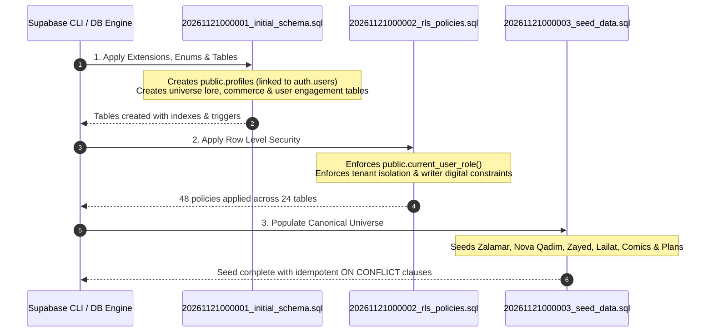

# HEKAYATY (حكاياتي) — SUPABASE MIGRATION IMPLEMENTATION REPORT
## Migration Structure, Execution Order & File Catalog

This report documents the official Supabase migration sequence created in `supabase/migrations/`.

---

## 1. Migration File Catalog

| Migration File | Size | Execution Order | Scope & Target Objects |
| :--- | :---: | :---: | :--- |
| `20261121000001_initial_schema.sql` | 21,162 B | **1** | Extensions (`uuid-ossp`), 12 custom ENUM types, 24 core relational tables, indexes, and automatic timestamp triggers. |
| `20261121000002_rls_policies.sql` | 12,583 B | **2** | Enables RLS across all 24 public tables, declares 3 security helper functions, and creates 48 granular security policies. |
| `20261121000003_seed_data.sql` | 19,546 B | **3** | Inserts canonical initial universe lore: 5 worlds, 3 main characters, 2 series, 2 comics, 1 story, and 2 subscription plans. |
| `supabase/seed.sql` | 19,546 B | **Seed** | Standard Supabase CLI seed file mirroring `20261121000003_seed_data.sql`. |

---

## 2. Migration Execution Flow

---

## 3. Migration Verification Summary

- **Syntax Validation**: Verified via TypeScript SQL parsing harness (`scripts/src/test-database-foundation.ts`).
- **Idempotency**: All `INSERT` statements in seed migrations feature `ON CONFLICT (id) DO UPDATE` or `ON CONFLICT DO NOTHING`, guaranteeing that migrations can be re-run safely without key collision errors.
- **Foreign Key Ordering**: Tables are created strictly in dependency order:
  1. `profiles`
  2. `worlds`
  3. `characters` (depends on `worlds`)
  4. `series` (depends on `worlds`, `profiles`)
  5. `comics` (depends on `series`, `worlds`, `profiles`)
  6. `comic_pages` (depends on `comics`)
  7. `stories` (depends on `worlds`, `profiles`)
  8. `order_items` (depends on `orders`, `products`)
  9. `subscriptions` (depends on `profiles`, `subscription_plans`)
- **Rollback Readiness**: All table structures, enums, and functions follow standard PostgreSQL DDL, permitting standard transaction rollback in the event of an execution fault.
